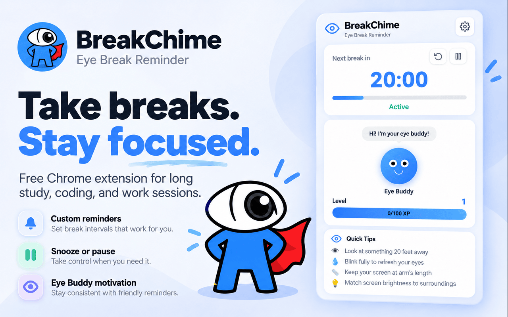
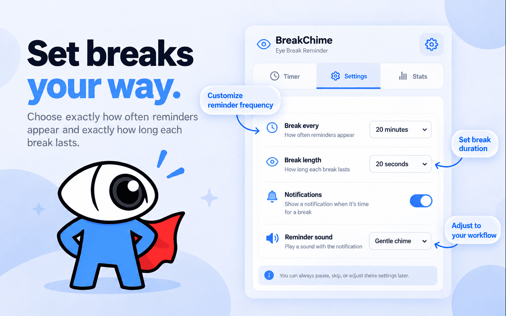
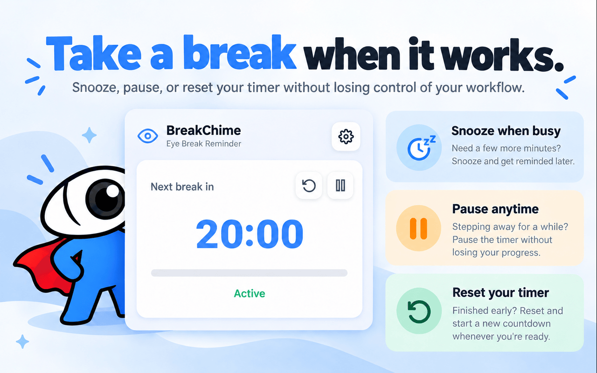
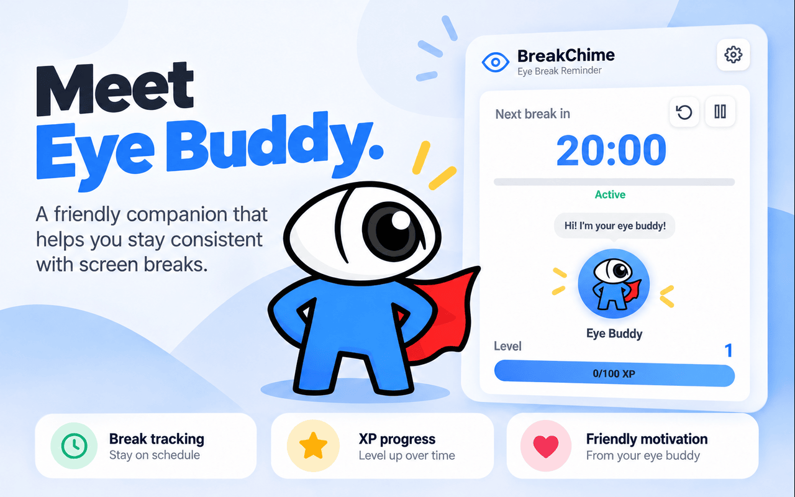
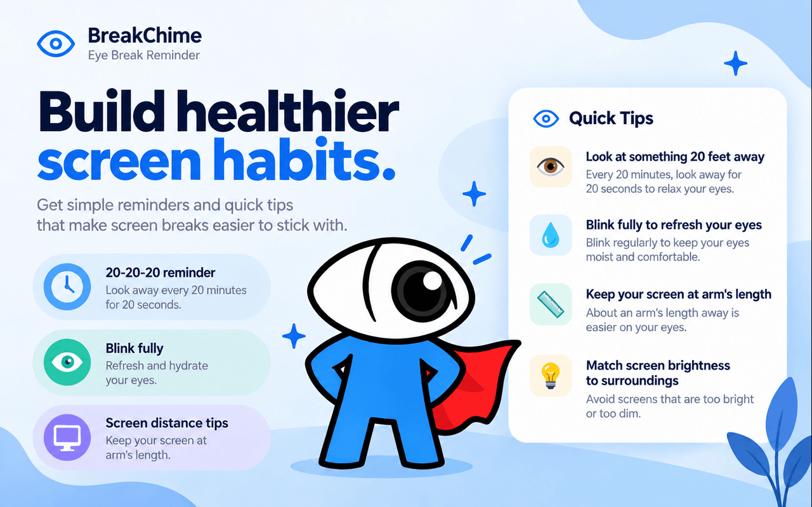

# 👁️ BreakChime

### Take breaks. Stay focused.

**A free Chrome extension that helps you remember to take screen breaks during long coding, studying, and work sessions.**

BreakChime combines customizable reminders, reliable background timers, notification sounds, and a friendly little Eye Buddy to make taking breaks easier.

Built and published by [Taransh Goyal](https://github.com/TaranshG).

[](https://chromewebstore.google.com/detail/breakchime-screen-break-r/bpfpaalmndaecjcjmhiphfdgcfajiapf)
[](https://breakchime.vercel.app)

---

## ✨ Meet BreakChime



I originally built BreakChime because I'd spend hours coding or studying without remembering to look away from my screen.

I wanted something simple that could remind me to take breaks without disrupting my workflow.

What started as a personal project became a published Chrome extension with **450+ downloads**.

---

## 📸 Features & Preview

### ⏰ Customize Your Breaks

Set your own reminder frequency, break duration, and notification preferences.



### ⏸️ Take Breaks on Your Terms

Busy in the middle of something? Pause, resume, snooze, or reset your timer whenever you need to.



### 🦸 Meet Eye Buddy

A friendly companion that makes building screen-break habits a little more fun.

BreakChime includes break tracking, XP progression, and Eye Buddy motivation to encourage consistency.



### 👀 Build Better Screen Habits

Get reminders inspired by the 20-20-20 rule, along with practical tips for screen distance, blinking, and display brightness.



---

## 🚀 Key Features

| Feature | Description |
|---|---|
| ⏰ Custom reminders | Choose how frequently you're reminded to take a break. |
| ⌛ Adjustable break duration | Set how long each break should last. |
| ⏸️ Pause and resume | Pause your countdown and resume from the remaining time. |
| 💤 Snooze | Delay reminders when you're busy. |
| 🔄 Reset timer | Restart your current reminder interval. |
| 🔔 Sound notifications | Choose a chime, preview sounds, or disable audio. |
| 🌙 Dark mode | Switch between light and dark appearances. |
| 🦸 Eye Buddy | A friendly companion with XP progression and motivation. |
| 📊 Break statistics | Track your screen-break activity. |
| 👀 Screen-break tips | Access simple reminders for healthier screen habits. |
| ⚙️ Persistent settings | Save preferences and timer state across popup closures. |

---

## 🛠️ Tech Stack

| Technology | Purpose |
|---|---|
| JavaScript | Application logic and timer management |
| HTML & CSS | Extension interface and styling |
| Chrome Extensions Manifest V3 | Browser extension architecture |
| Chrome Alarms API | Scheduling background reminders |
| Chrome Storage API | Persisting timer state and user preferences |
| Chrome Notifications API | Displaying break notifications |
| Chrome Offscreen API | Playing audio outside the extension popup |
| Node.js Test Runner | Automated tests with mocked Chrome APIs |

---

## 🧠 Engineering Highlights

Beyond the user-facing features, building BreakChime involved solving several interesting browser engineering challenges.

### 1. Reliable Background Timer Architecture

One of the biggest challenges with Chrome extensions is that the popup doesn't stay open.

BreakChime uses **Manifest V3 service workers, Chrome alarms, and persistent storage** to maintain timer state independently of the popup.

The timer system supports:

- Background reminders while the popup is closed.
- Persistent countdown state.
- Pausing without losing the remaining time.
- Resuming from the paused countdown.
- Resetting or replacing the reminder interval.
- Preserving paused state when unrelated preferences change.

This avoids relying on a continuously running popup or a fragile in-memory countdown.

### 2. Background Audio and Notifications

Chrome's extension service workers cannot directly behave like an ordinary page with persistent audio playback.

BreakChime uses the **Chrome Offscreen API** with an `AUDIO_PLAYBACK` document to play bundled chimes in the background.

The implementation handles:

- Creating and reusing an offscreen audio document.
- Concurrent audio requests.
- Muted notification preferences.
- Audio playback errors.
- Avoiding duplicate native notification sounds.
- Testing sounds without requiring the popup to remain open.

Audio is bundled locally with the extension. No external audio service is required.

### 3. Persistent State and Settings

BreakChime stores preferences and timer state using Chrome's storage APIs.

Settings include:

- Reminder interval
- Break duration
- Snooze duration
- Notification preferences
- Selected chime
- Dark mode

Certain settings save immediately, while timing-related changes use an explicit Save Settings action.

The timer also preserves important behavior across state changes. For example, updating sound preferences doesn't unexpectedly reset a paused countdown.

### 4. Automated Testing

Browser extensions have numerous edge cases involving background execution, notifications, and state synchronization.

BreakChime includes automated tests covering:

- Timer behavior and state transitions
- Notification interactions
- Muted reminders
- Audio playback failures
- Offscreen document reuse
- Concurrent background operations
- Platform-specific notification behavior
- Chrome API compatibility

The automated tests use mocked Chrome APIs. They validate extension logic but do not independently verify physical speaker output or operating-system notification banners.

---

## 📥 Installation

### Install from the Chrome Web Store

**[Install BreakChime for free](https://chromewebstore.google.com/detail/breakchime-screen-break-r/bpfpaalmndaecjcjmhiphfdgcfajiapf)**

1. Open the Chrome Web Store listing.
2. Click **Add to Chrome**.
3. Open Chrome's Extensions menu (puzzle-piece icon).
4. Pin BreakChime for easy access.
5. Open BreakChime and configure your settings.
6. Start your timer and get back to work!

You can adjust your reminder interval, break duration, sounds, and other preferences whenever you like.

---

## 💻 Running Locally

Want to explore the source code or test the extension locally?

### 1. Clone the repository

```bash
git clone https://github.com/TaranshG/BreakChime.git
```

Replace the repository URL if your actual repository name differs.

### 2. Load the extension in Chrome

1. Open `chrome://extensions`.
2. Enable **Developer mode**.
3. Click **Load unpacked**.
4. Select the directory containing the extension's `manifest.json`.

### 3. Run development checks

From the extension source directory:

```bash
node --test *.test.cjs
```

Check popup JavaScript syntax:

```bash
node --check popup.js
```

The tests mock browser APIs and do not require an actual operating-system notification to appear.

---

## 🔔 How Reminders Work

BreakChime uses Chrome's notification system to remind you when it's time for a break.

When a reminder appears, you can:

- Start your break by clicking the notification.
- Select a break or snooze action when available.
- Open the extension to access a pending reminder.

The extension also plays its selected chime independently through its background audio system.

**Important:** Chrome must be running and your computer must be awake for timely reminders. Sleeping your computer or quitting the browser may delay them.

---

## 🧰 Troubleshooting

### Not receiving notifications?

**macOS**

- Open System Settings → Notifications.
- Select your browser and allow notifications.
- Check whether Focus is suppressing notification banners.

**Windows**

- Open Settings → System → Notifications.
- Allow notifications for your browser.
- Check Do not disturb or Focus assist settings.

### Not hearing notification sounds?

- Enable Sound Notifications inside BreakChime.
- Use Test Sound in the extension settings.
- Check your system volume, audio output, and browser volume.
- Restart your browser if necessary.

### Still having problems?

Use **Report bug** in BreakChime's settings and include your browser, operating system, and the results of the notification and sound tests.

---

## 🎯 Why This Project Matters to Me

BreakChime started with a small problem I experienced personally.

But building it meant learning much more than how to display reminders.

I worked with background execution, browser lifecycle constraints, persistent storage, notification systems, audio handling, error cases, and automated testing.

It taught me how much engineering goes into making something that appears simple to the user.

And seeing hundreds of people download something I originally built for myself has been one of the most rewarding parts of the project.

---

## 🔗 Links

- 🌐 **Website:** [breakchime.vercel.app](https://breakchime.vercel.app)
- 🧩 **Chrome Web Store:** [Install BreakChime](https://chromewebstore.google.com/detail/breakchime-screen-break-r/bpfpaalmndaecjcjmhiphfdgcfajiapf)
- 💼 **LinkedIn:** [Taransh Goyal](https://linkedin.com/in/taransh-goyal)
- 💻 **GitHub:** [TaranshG](https://github.com/TaranshG)

---

<p align="center">
  Made with 💙 by <a href="https://github.com/TaranshG">Taransh Goyal</a>
</p>

<p align="center">
  <strong>Take breaks. Stay focused.</strong>
</p>